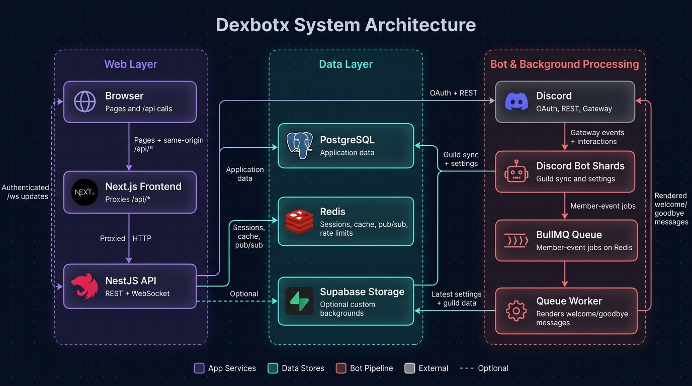

# DexBotX

DexBotX is an all-in-one Discord community bot built to help servers stay safer, more welcoming, and easier to manage. It brings anti-spam, social notifications, AI chat, auto roles, and personalized welcome and goodbye messages together in a fast, reliable, free, open-source bot with an easy web dashboard. Automatic moderation is coming soon.

## Features

- **Anti-Spam**
- **Social Notifications**
- **AI Auto Chat**
- **Auto Roles**
- **Welcome and Goodbye**
- **Auto Moderation** (coming soon; moderation slash commands are available)
- **Web Dashboard Easy Setup**
- **Open Source and Free**
- **Fast and Reliable**

**Not available yet:** Economy features, 24/7 music with custom playlists, and self-service editing of the bot's profile image, banner, or description are planned ideas, not features of the current release.

## Architecture

```text
┌───────────┐   ┌──────────────────┐   ┌────────────────┐   ┌──────────────┐
│  Browser  │[1]│ Next.js frontend │[2]│   NestJS API   │[3]│  PostgreSQL  │
│ dashboard │──▶│  proxies /api/*  │──▶│   REST · WS    │◀─▶│   app data   │
└─────┬─────┘   └──────────────────┘   └──┬───┬────────┬┘   └──────────────┘
      ▲                                   ▲   ▲        ┊
      └ authenticated /ws · live updates ─┘   ▼        ┊
                                       ┌──────┴─────┐  ┊    ┌────────────────────┐
                                       │   Redis    │  └┄┄┄▶│  Supabase Storage  │
                                       │ sessions   │       │ custom backgrounds │
                                       │ cache      │       └────────────────────┘
                                       │ pub/sub    │
                                       │ rate limits│
                                       └──────┬─────┘
                                              ▲  BullMQ keeps its jobs in Redis
                                              ┊
BOT & BACKGROUND FLOW                         ┊
───────────────────────────────────────────── ▼─────────────────────────────────────────────
┌─────────────────┐   ┌────────────┐   ┌──────┴───────┐   ┌──────────────┐   ┌─────────────┐
│ Discord Gateway │[4]│ Bot shards │[5]│ BullMQ queue │[6]│ Queue worker │[7]│ Discord API │
│  gateway events │──▶│ guild sync │──▶│ member jobs  │──▶│ renders msgs │──▶│    REST   │
└─────────────────┘   └─────┬──────┘   └──────────────┘   └───────┬──────┘   └─────────────┘
                            │                                     ▲
                            ▼                                     │
                      ┌───────────────────────────────────────────────────────┐
                      │          PostgreSQL · same database as above          │
                      │ bot writes sync + settings · worker reads latest data │
                      └───────────────────────────────────────────────────────┘
```

<div align="center">
  
</div>

The frontend proxies API requests through `/api/*`. The backend runs as three long-lived processes: the HTTP API, Discord bot, and queue worker. All backend processes share the same PostgreSQL database and Redis instance.

## Requirements

- Node.js 22 or newer and npm.
- PostgreSQL and Redis instances reachable by the backend.
- A Discord application and bot. Enable the **Server Members Intent** to receive join and leave events.

You can run the app on any hosting provider that supports the required Node.js processes, PostgreSQL, and Redis. The dashboard needs a Node.js/Next.js host or a compatible container host. Custom background uploads are optional and currently use Supabase Storage; the rest of the app does not require Supabase.

## Run locally 

1. Configure the backend:

   ```powershell
   cd backend
   Copy-Item .env.example .env
   npm install
   ```

   Fill in the required database, Redis, Discord, and session settings in `backend/.env`. Generate a session key with:

   ```powershell
   node -e "console.log(require('node:crypto').randomBytes(32).toString('hex'))"
   ```

2. Build the backend and apply database migrations once:

   ```powershell
   npm run build
   npm run db:migrate
   ```

3. Run each backend process in a separate terminal from `backend/`:

   ```powershell
   npm run start:dev
   npm run start:bot:dev
   npm run start:worker:dev
   ```

4. In another terminal, run the frontend:

   ```powershell
   cd frontend
   npm install
   npm run dev
   ```

   Open `http://localhost:3000`. For Discord login, register `http://localhost:3000/api/auth/callback` in the Discord application's OAuth2 redirect URLs.

See [backend/README.md](./backend/README.md) for backend configuration and [frontend/README.md](./frontend/README.md) for frontend configuration.

## Self-hosting

- Set the backend environment variables for your deployment. Set `WEB_URL` to the public dashboard URL and `WS_PUBLIC_URL` to the public WebSocket URL.
- Run `npm run db:migrate` from `backend/` once for each deployment that adds migrations, before starting updated backend processes.
- Run the API with `npm run start`, the bot with `npm run start:bot`, and the worker with `npm run start:worker`. Give all three the same backend environment and shared database and Redis URLs.
- Build and run the frontend with `npm run build` and `npm run start`. Set `BACKEND_URL` to the API's HTTPS URL **at build time**; Next.js uses it for the `/api/*` proxy.
- Register `<WEB_URL>/api/auth/callback` with Discord. Keep database credentials, Redis credentials, Discord secrets, and the session encryption key on backend services only.

The API exposes `GET /health` for liveness and `GET /health/ready` for PostgreSQL and Redis readiness.

## Development

Run commands from `backend/` or `frontend/`:

| Command | Purpose |
|---|---|
| `npm run lint` | Lint the project package |
| `npm run typecheck` | TypeScript checks |
| `npm test` | Run unit tests |
| `npm run build` | Create a production build |

The backend also provides `npm run test:e2e`, `npm run db:generate`, and `npm run db:migrate`. See each package README for details.

## Contributing

Contributions and bug reports are welcome. Keep secrets out of commits, include tests for behavior changes, and run the relevant lint, typecheck, and test commands before opening a pull request.

<h3> 🎉 Thank You for Checking Out the Project! If you enjoy this project, feel free to ⭐️ it and share it with others!</h3>


<div align="center">
  
</div>
